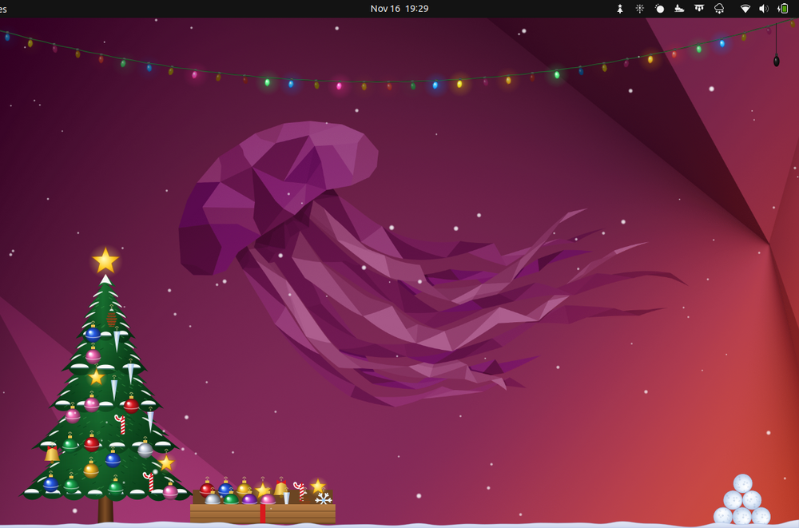
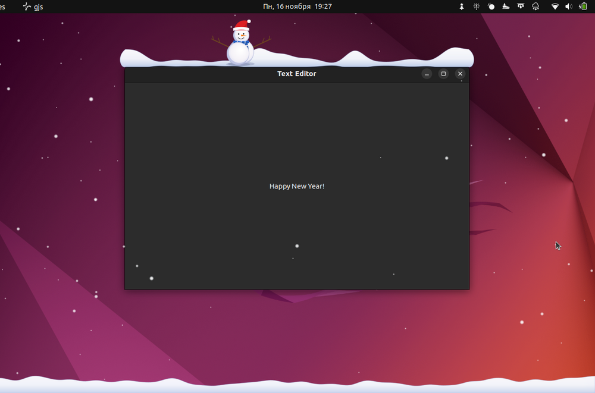
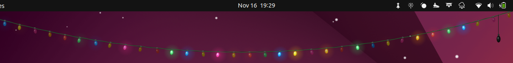
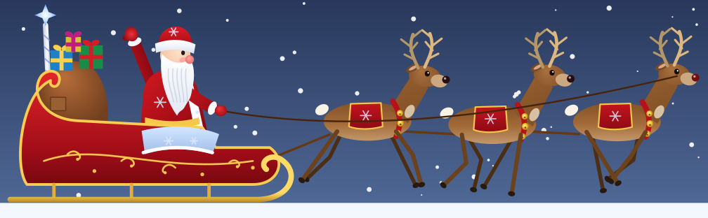
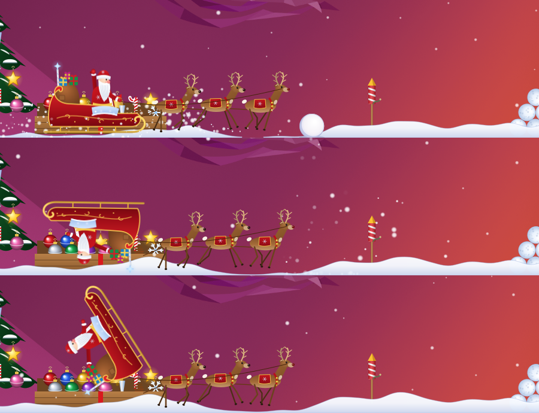
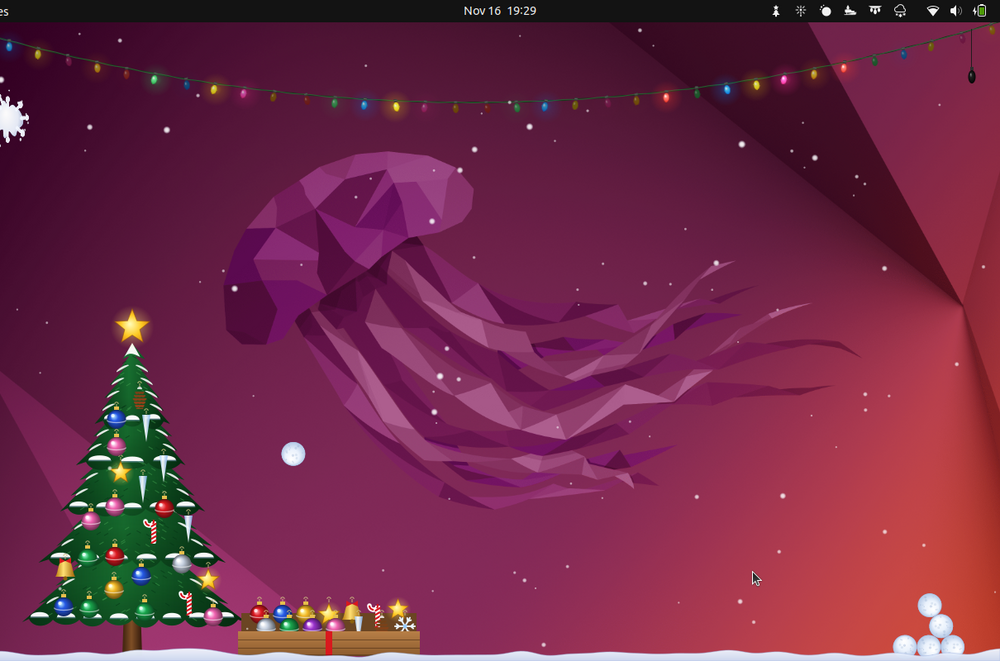
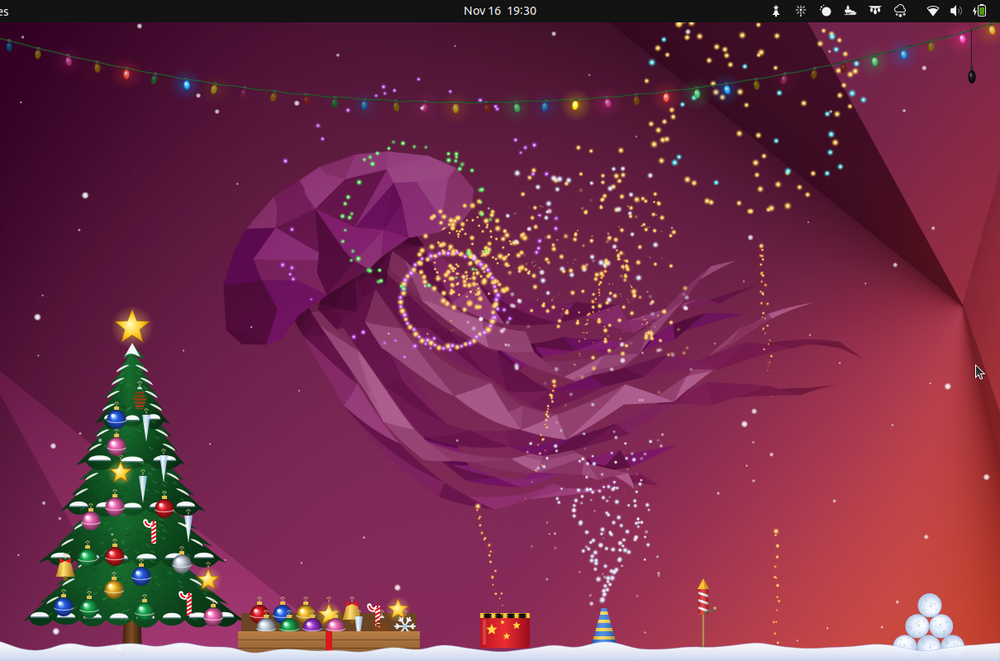
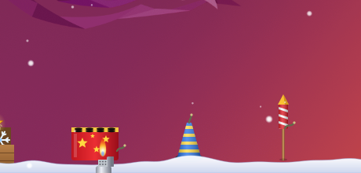
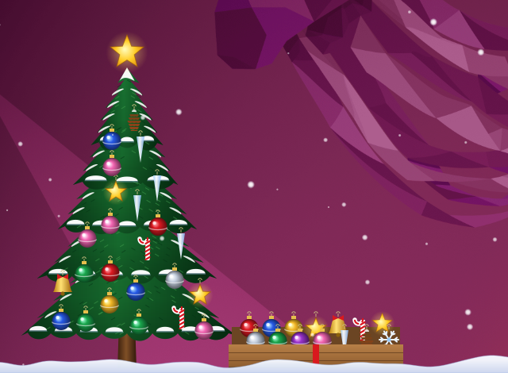

# ❄ New Year Effects for Windows

New Year effects for the Windows 10/11 desktop: snow you can make snowmen from, a garland, Ded Moroz on a sleigh, snowballs, fireworks you light with a lighter, and a Christmas tree to decorate.
Новогодние эффекты для рабочего стола Windows 10/11: снег, из которого лепятся снеговики, гирлянда, Дед Мороз на санях, снежки, фейерверк с зажигалкой и ёлка, которую можно нарядить.



**⬇ [Download / Скачать](https://github.com/mpreterer/ng-win-extentions/releases/latest)**

**[Русский](#русский) · [English](#english)**

The app and its settings are in Russian and English. / Программа и настройки — на русском и английском.

The Windows port of [ng-gnome-extensions](https://github.com/mpreterer/ng-gnome-extensions). / Версия для Windows расширений [ng-gnome-extensions](https://github.com/mpreterer/ng-gnome-extensions).

---

## Русский

### Установка — 4 шага

1. Откройте страницу **[Releases](https://github.com/mpreterer/ng-win-extentions/releases/latest)** и скачайте файл **`NewYearEffects-Setup.exe`** (раздел *Assets*).
2. Запустите скачанный файл. Права администратора не нужны, программа ставится только для вашего пользователя.
3. Если появится синее окно **«Система Windows защитила ваш компьютер»** — нажмите **Подробнее** → **Выполнить в любом случае**.
   Так Windows реагирует на любую программу без платной цифровой подписи.
4. Через пару секунд пойдёт снег, а у часов на панели задач появится значок-ёлочка 🎄.
   Не видно значка — нажмите стрелку **`^`** слева от часов.

Всё. Программа сама запускается вместе с Windows (это отключается в меню значка).
В меню «Пуск» появляется ярлык **New Year Effects** — если вы закрыли программу, запустите её оттуда.

**Без установки:** скачайте **`NewYearEffects-Portable.exe`** и просто запустите его — ничего не устанавливается.

### Как пользоваться

**Щёлкните по ёлочке в трее** — откроется меню: каждый эффект можно включить, выключить и настроить.
**Настройки…** в том же меню — окно со всеми параметрами и горячими клавишами.

**Язык.** Русский или английский выбирается сам по языку Windows. Поменять: меню значка → **Язык / Language**, или **Настройки… → Общие → Язык**.

### Что внутри

| | Эффект | Что делает | Клавиши |
|---|---|---|---|
| ❄ | **Снег** | Падает и копится сугробами на заголовках окон и над панелью задач. Курсором скатываются снежки, из них складываются снеговики | `Ctrl+Alt+X` — вкл./выкл. |
| 💡 | **Гирлянда** | Мигает вдоль верха экрана; потяните шнурок справа — свет включится или выключится | `Ctrl+Alt+G` — вкл./выкл. |
| 🛷 | **Дед Мороз** | Раз в 3 часа проезжает на санях с оленями над панелью задач. Врезался в снежный шар — сани переворачиваются | `Ctrl+Alt+D` — проехать сейчас |
| ⚪ | **Снежки** | Горка снежков: хватайте мышью и бросайте в край экрана | `Ctrl+Alt+B` — вкл./выкл. |
| 🎆 | **Фейерверк** | Ставьте ракеты, батареи салютов и фонтаны и поджигайте их мышкой, как зажигалкой | `Ctrl+Alt+F` — салют сейчас |
| 🎄 | **Ёлка** | Ёлка и ящик игрушек: вешайте игрушки мышью, звезду — на макушку. Наряд сохраняется | — |

Каждый эффект можно показывать **поверх окон**, **только на пустом рабочем столе** или **под окнами** (пункт «Показывать»).
Эффекты не мешают работать: клики проходят сквозь снег и гирлянду, мышь «цепляет» только сами предметы.
В полноэкранной игре или видео эффекты поверх окон убираются.

### Как играть

#### ❄ Снег, снежки и снеговики



- Снег копится плотной шапкой на верхней кромке окон и над панелью задач. Хотите сразу — меню → **Снег → Намести сугробы**.
- Сдвиньте или потрясите окно — снег осыплется; закройте или сверните — всё, что на нём, упадёт вниз.
- **Скатать снежок:** проведите курсором вдоль сугроба (без нажатия). Шар растёт и оставляет чистую колею.
- **Слепить снеговика:** возьмите шар мышью и отпустите над другим шаром. Из 2–5 шаров получается снеговик в шапке и шарфе, с носом-морковкой; с 4 шаров — варежки и метла, с 5 — звезда на шапке.
- Схватите снеговика за голову — снимете голову; за нижний шар — перенесёте целиком.

#### 💡 Гирлянда



Потяните мышью шнурок справа вниз — свет включится или выключится. Режим мигания, цвета лампочек и цвет провода — в меню.

#### 🛷 Дед Мороз



Проезжает сам раз в 3 часа (меняется в меню) или по `Ctrl+Alt+D`.
**Поставьте у него на пути снежный шар** (скатайте его по нижнему сугробу): сани врезаются, переворачиваются, Дед Мороз машет руками — потом кувырок обратно, и упряжка едет дальше.



#### ⚪ Снежки



Возьмите снежок из горки в углу и бросьте — он разобьётся о край экрана и медленно сползёт. По умолчанию горка видна на пустом рабочем столе (сверните окна: `Win+D`).

#### 🎆 Фейерверк



1. Меню → **Фейерверк → Поставить ракету / батарею салютов / фонтан**, затем щёлкайте по экрану (правая кнопка или `Esc` — готово).
2. Наведите курсор на фейерверк — он станет зажигалкой. **Зажмите кнопку мыши**, пока не загорится фитиль.
3. Ракета взлетает и взрывается, батарея даёт 12 залпов, фонтан бьёт искрами. Правая кнопка по фейерверку — убрать его.

**Салют сейчас!** (`Ctrl+Alt+F`) — залп без подготовки.



#### 🎄 Ёлка



- Ёлка стоит на рабочем столе — сверните окна (`Win+D`), чтобы её увидеть.
- Возьмите игрушку из ящика рядом и отпустите над веткой — она повиснет и покачается. Большая звезда ставится на макушку.
- Утащите игрушку с ёлки — снимете её. В меню есть **Нарядить автоматически** и **Снять все игрушки**.
- Пока идёт снег, на ветках копится снег, потом медленно тает.

*Скриншоты сделаны в версии для GNOME — эффекты в Windows выглядят так же.*

### Если что-то не так

- **Нет значка у часов** — нажмите `^` рядом с часами. Чтобы значок был виден всегда: перетащите его мышью на панель задач.
- **Горячая клавиша не работает** — её заняла другая программа. Поменяйте сочетание в **Настройках…**, в разделе этого эффекта.
- **Тормозит** — уменьшите число снежинок: меню → **Снег → Снежинок**.
- **Выключить на время** — меню значка → **Выход**. Снова включить — ярлык **New Year Effects** в «Пуске».

### Удаление

**Пуск → Параметры → Приложения → Установленные приложения → New Year Effects → ⋯ → Удалить.**
Автозапуск удаляется вместе с программой. Настройки остаются в папке `%APPDATA%\New Year Effects` — её можно удалить вручную.

### Сборка из исходников

Нужен [Node.js](https://nodejs.org) 20 или новее.

```bash
git clone https://github.com/mpreterer/ng-win-extentions.git
cd ng-win-extentions
npm install
npm start          # запустить без установки
npm run dist       # собрать установщик и portable-версию в папку dist
```

Устройство: Electron, два прозрачных окна на весь экран (верхнее — поверх окон, нижнее — сразу над рабочим столом),
клики проходят насквозь везде, кроме самих предметов. Положения окон для сугробов берутся через Win32 (`koffi`).
Рисунки и физика перенесены из расширений GNOME (Cairo → Canvas): `src/overlay/modules/`.

---

## English

### Install in 4 steps

1. Open the **[Releases](https://github.com/mpreterer/ng-win-extentions/releases/latest)** page and download **`NewYearEffects-Setup.exe`** (under *Assets*).
2. Run the downloaded file. No admin rights needed — it installs for your user only.
3. If a blue **“Windows protected your PC”** window appears, click **More info** → **Run anyway**.
   Windows shows this for any app without a paid code-signing certificate.
4. In a couple of seconds snow starts falling and a little tree icon 🎄 appears next to the clock.
   Can't see it? Click the **`^`** arrow left of the clock.

That's it. The app starts with Windows (turn it off in the icon menu).
The Start menu gets a **New Year Effects** shortcut — use it if you closed the app.

**No install:** download **`NewYearEffects-Portable.exe`** and just run it.

### How to use

**Click the tree icon in the tray** to open the menu: turn each effect on or off and tune it.
**Settings…** in the same menu opens a window with every option and the hotkeys.

**Language.** English or Russian is picked from your Windows language. To change it: icon menu → **Language / Язык**, or **Settings… → General → Language**.

### What you get

| | Effect | What it does | Hotkey |
|---|---|---|---|
| ❄ | **Snow** | Falls and piles up on window title bars and above the taskbar. Roll snowballs with the pointer and stack them into snowmen | `Ctrl+Alt+X` — on/off |
| 💡 | **Garland** | Blinks along the top of the screen; pull the cord on the right to switch the lights | `Ctrl+Alt+G` — on/off |
| 🛷 | **Ded Moroz** | Rides a reindeer sleigh above the taskbar every 3 hours. Hits a snowball — the sleigh flips over | `Ctrl+Alt+D` — ride now |
| ⚪ | **Snowballs** | A pile of snowballs: grab one and throw it at the screen edge | `Ctrl+Alt+B` — on/off |
| 🎆 | **Fireworks** | Place rockets, firework cakes and fountains and light them with the mouse like a lighter | `Ctrl+Alt+F` — show now |
| 🎄 | **Christmas tree** | A tree and a box of toys: hang the toys with the mouse, the star goes on top. Decorations are kept | — |

Each effect can be shown **above windows**, **only on an empty desktop** or **below windows** (the “Show” option).
The effects don't get in the way: clicks pass through the snow and the garland, the mouse only grabs the objects themselves.
In a fullscreen game or video the effects above windows are hidden.

### How to play

- **Snow:** move the pointer along a drift (no click) to roll a snowball. Drag a ball onto another one to build a snowman (2–5 balls). Move or shake a window to knock the snow off. Want drifts right away? Menu → **Snow → Pile up snow now**.
- **Garland:** pull the cord on the right down with the mouse.
- **Ded Moroz:** `Ctrl+Alt+D`. Roll a snowball along the bottom drift and put it in his way — the sleigh flips over.
- **Snowballs:** grab one from the pile in the corner and throw it. The pile is on the empty desktop by default (minimize windows: `Win+D`).
- **Fireworks:** menu → **Fireworks → Place a rocket / cake / fountain**, click on the screen (right click or `Esc` when done). Point at a firework — the pointer turns into a lighter — and **hold the mouse button** until the fuse catches. Right click a firework to remove it. `Ctrl+Alt+F` launches a show right away.
- **Christmas tree:** it stands on the desktop (`Win+D`). Drag toys from the box onto the branches, the star onto the top. **Decorate automatically** and **Take all toys off** are in the menu.

*The screenshots are from the GNOME version — the effects look the same on Windows.*

### Troubleshooting

- **No icon by the clock** — click `^` next to the clock; drag the icon onto the taskbar to keep it visible.
- **A hotkey doesn't work** — another app took it. Change it in **Settings…**, in that effect's section.
- **Slow** — fewer snowflakes: menu → **Snow → Snowflakes**.
- **Turn it off for now** — icon menu → **Quit**. Start it again from the **New Year Effects** Start menu shortcut.

### Uninstall

**Start → Settings → Apps → Installed apps → New Year Effects → ⋯ → Uninstall.**
The autostart entry is removed too. Settings stay in `%APPDATA%\New Year Effects` — delete that folder by hand if you like.

### Build from source

[Node.js](https://nodejs.org) 20 or newer:

```bash
git clone https://github.com/mpreterer/ng-win-extentions.git
cd ng-win-extentions
npm install
npm start          # run without installing
npm run dist       # build the installer and the portable exe into dist/
```
